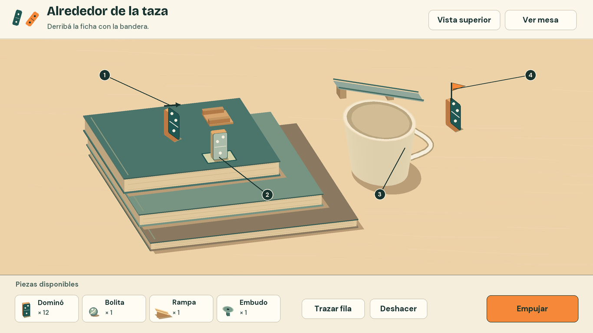

# Dirección de arte de Tuki

Tuki es un rompecabezas de dominós que se arma sobre una mesa de cocina. La pintura en los cantos permite seguir una fila al caer. La sombra bajo cada pieza revela dónde apoya. Cuando una cadena se corta, la mesa queda a la vista para que el jugador pueda decidir qué mover. Estas tres decisiones guían el arte del MVP.

## Cómo usar las guías

| Guía | Qué resuelve |
| --- | --- |
| [Identidad](identidad.md) | Marca separable, colores de producción, tipografía y voz rioplatense. |
| [Mesa y piezas](mesa-y-piezas.md) | Encuadres, luz, materiales, superficies de apoyo y lectura de los seis mecanismos de la cadena. |
| [Interfaz](interfaz.md) | Bandeja del editor, selección, límites del trazo y controles de prueba, repetición y resultado. |
| [Movimiento y sonido](movimiento-y-sonido.md) | Qué se oye en cada contacto, cuándo entran los dos golpes de victoria y cómo se comunica con el audio apagado. |
| [Hoja de validación](validacion.md) | Revisión de las láminas, prueba con cinco personas y registro de rendimiento en dos navegadores. |

## Referencias del MVP

El concepto A fija el carácter de la maqueta, la combinación petróleo y mandarina, la madera pintada y la luz cálida. Las láminas llevan esas decisiones al encuadre y al inventario de cada desafío. En particular, todas las caras de dominó comparten un único saldo. [Concepto A aprobado](referencias/concepto-a.png)

Las reglas, el orden de los desafíos y las condiciones de victoria provienen de la especificación funcional 0.1. El Word incluye el esquema de los dos recorridos de la taza. [Especificación en Markdown](../mvp-dominos-3d.md) · [Especificación en Word](../MVP%20del%20juego%20de%20domin%C3%B3s%203D.docx)

Las láminas son maquetas de escritorio para mouse. Los números sobre la mesa y las flechas de las láminas de revisión son anotaciones para el equipo. Los controles, las medidas en píxeles y los tiempos del remate se pueden reproducir con cualquier motor. La escala física definitiva se calibra con los montajes jugables.
