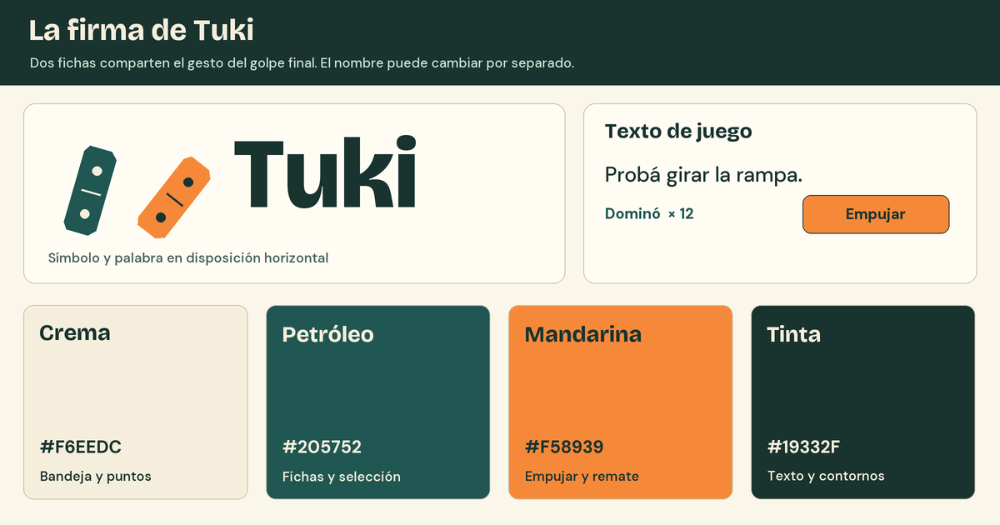

# Identidad

Una fila quieta tiene que invitar a darle el primer empujón. Las fichas tienen caras petróleo, puntos grabados con fondo crema y un canto de madera con una franja cálida. Al girar o caer se ve primero el cambio de silueta y después el detalle de pintura. El humor aparece cuando la máquina por fin funciona.

## Marca para el MVP

El símbolo tiene dos fichas de la misma familia, inclinadas hacia la derecha. La primera llega a 16° y la segunda a 38°. Los puntos y la división de cada cara permiten reconocerlas también en una impresión monocroma. La inclinación final es la pose de cierre de la victoria.

| Original vectorial | Uso |
| --- | --- |
| [Símbolo solo](marca/simbolo.svg) | Cabecera del editor y pose final del remate. |
| [Palabra Tuki](marca/palabra.svg) | Nombre del MVP. Letras convertidas en contornos para mantener la forma al compartir el archivo. |
| [Firma horizontal](marca/firma.svg) | Presentaciones y pantallas con espacio para símbolo y palabra. |

Sobre crema, usar la firma en sus colores originales. Dejar alrededor un margen de al menos el ancho de una ficha del símbolo. Usar el símbolo a partir de 32 px de ancho y la firma horizontal a partir de 120 px. Para cambiar el nombre, sustituir la palabra, recomponer la firma y revisar la exclamación de victoria. Los tiempos y las poses se conservan en el símbolo.

## Color en pantalla

| Color | Muestra sRGB | Aplicación |
| --- | --- | --- |
| Crema | `#F6EEDC` | Bandeja, puntos y texto sobre petróleo. La cerámica puede variar con la luz. |
| Petróleo | `#205752` | Caras de dominó, contorno de apoyo y control seleccionado. El aro o el borde marcan la selección. |
| Mandarina | `#F58939` | Acción principal, bandera de meta y segunda ficha del símbolo. Los detalles pintados ocupan superficies pequeñas. |
| Tinta | `#19332F` | Texto principal, línea de dirección y contorno del botón mandarina. |

En colores planos, tinta sobre mandarina da **5,48:1**, tinta sobre crema **11,69:1** y crema sobre petróleo **7,14:1**. Usar esos pares para texto. Separar la interfaz de la madera con un fondo opaco. Una posición inválida suma trama, cruz y motivo escrito. En escala de grises se siguen distinguiendo la acción principal por su tamaño y etiqueta, el inicio por la flecha y la meta por la bandera.

## Letras y voz

La lámina y las maquetas prueban Bricolage Grotesque en los títulos y DM Sans en la interfaz, con acentos, signos de apertura y cantidades reales del juego. Usar Bricolage de peso 750–800 para títulos de 26–36 px y DM Sans de peso 500–700 para ayudas, botones y cantidades de 15–18 px a 1366 × 768. Al cambiar de una a dos cifras, reservar el ancho de «× 12» para evitar saltos en la bandeja. [Bricolage Grotesque](https://github.com/google/fonts/tree/main/ofl/bricolagegrotesque) · [DM Sans](https://github.com/google/fonts/tree/main/ofl/dmsans)

| Momento | Texto de referencia |
| --- | --- |
| Objetivo | «Derribá la ficha con la bandera.» |
| Acción | «Empujar», «Trazar fila», «Retirar», «Deshacer», «Volver a editar». |
| Corregir un apoyo | «Apoyá toda la base.» Si hay superposición, «Separá las piezas.» |
| Entender un límite | «Límite de fichas». En un borde, «Empezá otro trazo abajo.» |
| Fin del intento | «Cadena detenida» invita a observar. «¡Tuki! · Meta alcanzada» permite celebrar y seguir. |

Al dar una ayuda, nombrar el gesto o la superficie. «Probá girar la rampa» sirve cuando el jugador pide orientación. Durante una prueba de invención, mostrar solo el objetivo y el inventario para que descubra su recorrido.
