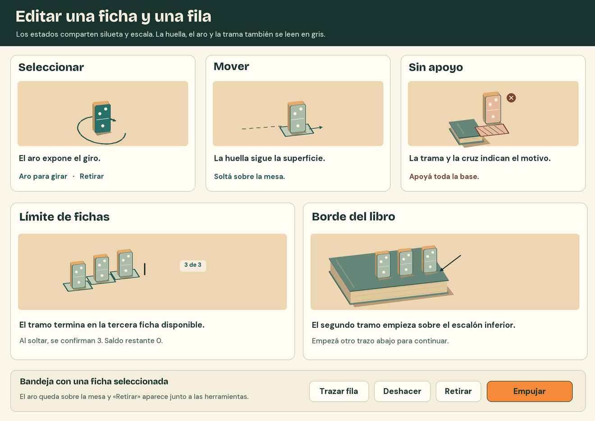
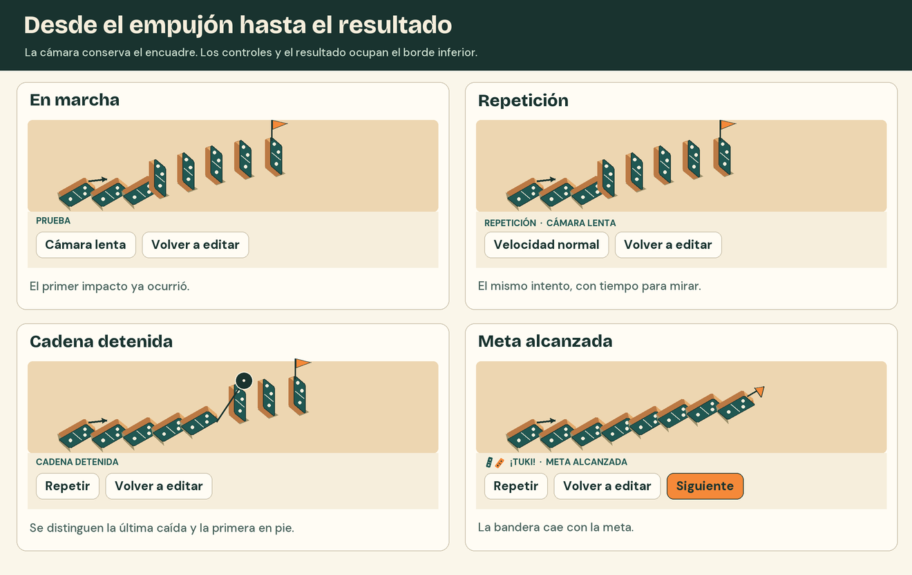

# Interfaz

El jugador debería poder dibujar, empujar y volver a la misma ficha sin perder su lugar. La mesa ocupa el centro, la cámara se maneja desde el borde superior y la bandeja inferior cambia de herramientas según el momento del intento.

## Composición

La portada presenta la firma, la fila de muestra y las acciones de entrada sobre la mesa real. La muestra cae una vez por carga. En movimiento reducido la fila aparece en su pose final. El selector reúne ocho fichas en un atril. La biblioteca permite recorrer las creaciones guardadas y muestra un armado a la vez.

El tablero ocupa todo el viewport. En partida, volver y el nombre del nivel quedan arriba a la izquierda, las vistas y preferencias arriba a la derecha, las piezas y herramientas abajo a la izquierda y «Empujar» abajo a la derecha. Los controles táctiles tienen un mínimo de 44 px. En vertical, el inventario largo y el atril se desplazan dentro de su bandeja. [Referencias del rediseño](prototipos-ui/03-editor.png)

## Editar una pieza o una fila

| Gesto | Lo que se ve | Qué queda al terminar |
| --- | --- | --- |
| Elegir una miniatura y señalar | Silueta clara, huella en la superficie señalada y flecha de caída o de salida. | Un clic confirma y descuenta una unidad. Cancelar conserva el saldo y el armado. |
| Seleccionar y arrastrar | Contorno con aro en reposo. Durante el arrastre, la huella acompaña el plano de apoyo. | Al soltar sobre una posición válida se mueve solo esa pieza, incluso si pertenecía a una fila. Arrastrar el aro cambia su orientación. |
| Soltar en una posición inválida | Trama y cruz en la huella. Según el motivo, «Separá las piezas», «Volvé a la mesa» o «Apoyá toda la base». | Una pieza existente recupera su posición anterior. Una nueva vuelve a la bandeja. Un hueco entre fichas es una colocación válida. |
| Arrastrar con «Trazar fila» | Siluetas a intervalos sugeridos, orientadas según la tangente de la curva. Contador del tramo junto al cursor. Suavizar el temblor pequeño del mouse. | Al soltar se confirma el tramo visible. «Deshacer» devuelve toda la fila y su saldo en una sola acción. |
| Agotar o cambiar de apoyo | Al alcanzar el saldo, aparece «Límite de fichas» y una barra de fin en la última silueta. Al borde de un libro, la vista previa acaba en la última base con apoyo completo. | Para bajar un escalón se comienza otro trazo. Con saldo cero, la miniatura conserva su nombre y muestra «× 0». |
| Retirar y deshacer | La pieza seleccionada tiene el aro y el botón «Retirar». | Retirar devuelve una unidad. «Deshacer» repone el estado inmediatamente anterior, incluida la cantidad. |

## Observar, repetir y volver

- **Empujar.** Aplicar el único impulso y cambiar la bandeja a «Prueba». Dejar cámara, velocidad y «Volver a editar» disponibles aunque haya piezas en movimiento. La cámara conserva el punto de vista.
- **Cámara lenta y repetición.** Mostrar el estado activo en texto. En lenta, la acción disponible es «Velocidad normal». «Repetir» empieza desde el empujón del último armado con las piezas en reposo y la llave cerrada. El orden de los contactos se conserva.
- **Cadena detenida.** Cuando las piezas que siguen sobre la mesa quedan en reposo y la meta está de pie, mostrar el mensaje, «Repetir» y «Volver a editar» en la bandeja. La última caída y la primera pieza en pie permanecen a la vista. En la lámina, la llamada sobre el hueco explica qué inspeccionar en la revisión.
- **Victoria.** Al caer la meta por la cadena, cambiar «Prueba» por «Meta alcanzada» en la bandeja. Al asentarse las piezas, mostrar el nombre del nivel o de la mesa resuelta y el acceso al Taller cuando se desbloquea. «Repetir» reproduce la cadena. Las opciones de reproducción reúnen velocidad y edición. Las piezas desbloqueadas se consultan en el Taller. El resumen permanece hasta la elección.
- **Volver a editar.** Restaurar el armado anterior al empujón, con sus posiciones, orientaciones, inventario y compuerta. La persona puede corregir una sola ficha y volver a probar sin reconstruir la fila.
