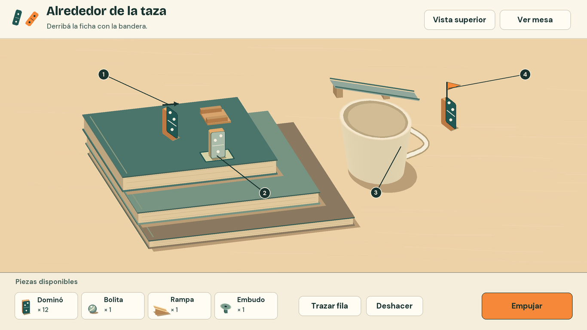
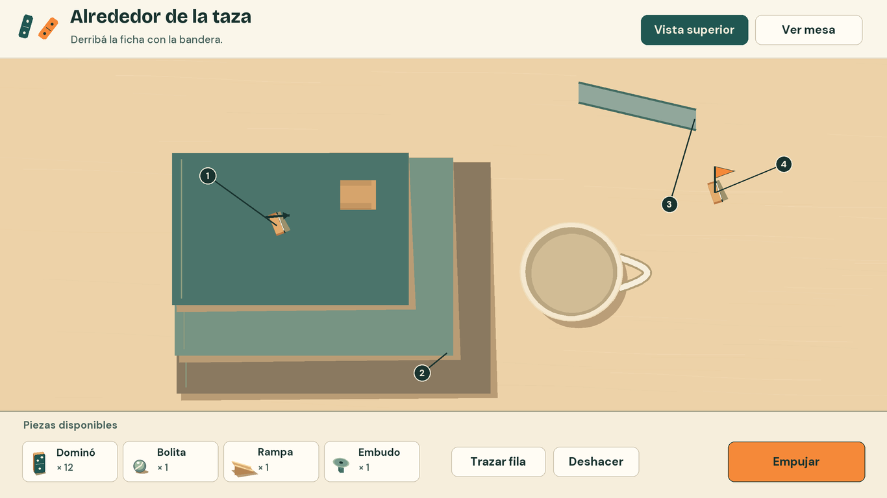
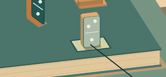
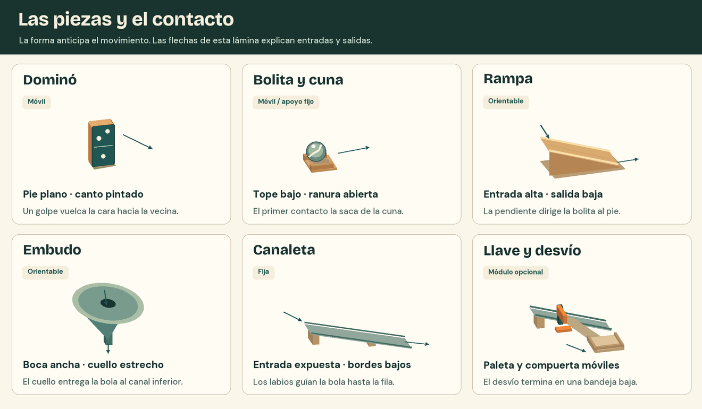
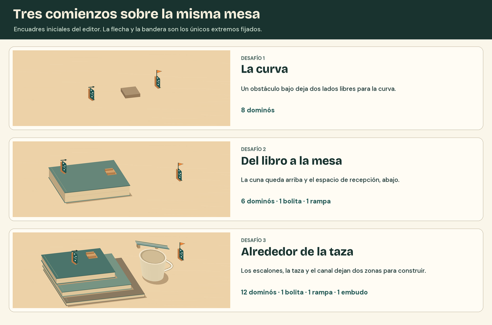
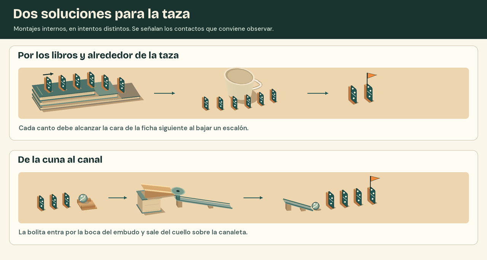

# Mesa y piezas

Abrí «Alrededor de la taza» en vista oblicua. La pregunta al encuadrar es si se puede seguir con la mirada el borde del libro, encontrar la entrada del canal y ver la bandera detrás de la taza. Si dos de esos elementos se superponen, probá primero a orbitar unos grados. Agrandar la bandera o iluminar toda la mesa corregiría otra cosa.

## La taza a tamaño de juego

1. **Inicio.** La flecha está por encima de la ficha fija. Se lee sobre la tapa del libro y señala el sentido del empujón.
2. **Colocación.** Una ficha en vista previa muestra su base sobre la tapa. La bandeja todavía conserva las doce fichas disponibles.
3. **Taza.** La silueta crema tiene el asa hacia la derecha. Dejar una franja libre junto a los escalones para leer el recorrido lateral y conservar a la vista los extremos de la canaleta.
4. **Meta.** La bandera y el pie de la ficha se ven más allá de la taza. La punta de la bandera queda dentro de la zona de mesa al abrir el nivel.

En planta, **1** conserva la dirección inicial, **2** señala dónde cambia la superficie, **3** marca el extremo de salida de la canaleta y **4** identifica la meta. Usar esta vista para alinear en horizontal. Volver a la vista oblicua para juzgar la altura entre salida, apoyo y ficha receptora. «Ver mesa» recupera el encuadre de apertura.

El recorte corresponde a los píxeles **x = 325–654, y = 274–426** de la vista oblicua, con origen arriba a la izquierda. Abrirlo al 100 %. Se deben distinguir el canto cálido, el contorno de la huella y el espesor de las páginas. La huella toca la tapa superior y termina antes del borde. Si la textura borra alguna de esas líneas, reducir primero la intensidad de la veta.

## Cámara, luz y materiales

| Elemento | Decisión de producción | Comprobación en pantalla |
| --- | --- | --- |
| Cámara | Vista oblicua con poca distorsión. Comenzar con una elevación de 30–40° sobre la mesa y ajustar según la silueta de la taza. Para planta, apuntar perpendicularmente a la mesa. | Inicio, meta y sus apoyos caben por encima de la bandeja. En planta se pueden alinear dos centros. |
| Luz y sombras | Una luz cálida y amplia entra por arriba a la izquierda. Relleno suave y sombra corta de contacto debajo de cada apoyo. | Una pieza apoyada toca su sombra. Al mover una ficha entre alturas, la base y la sombra pasan al nuevo plano juntas. |
| Madera y libros | Veta clara, de bajo contraste. Cantos suavizados. Resolver cada bloque de páginas con dos o tres líneas que se pierden con la distancia. | En una fila se distinguen los huecos. En los libros se pueden contar los escalones. |
| Cerámica y vidrio | Taza mate con borde y asa legibles. La bolita lleva un reflejo pequeño y una vuelta de color que permite percibir la rodadura. | La taza cede protagonismo a la fila. La bolita sigue siendo visible al pasar de la madera al canal. |
| Desgaste y detalle | Concentrar el desgaste en aristas y apoyos. Reservar el grano fino para inspección cercana. Usar la forma real del objeto para el contacto con piezas vecinas. | Al volver al encuadre inicial se mantienen las mismas siluetas y direcciones de salida. |

## Piezas y apoyos

| Pieza | Qué tiene que poder anticipar el jugador |
| --- | --- |
| Dominó | El pie es plano y la cara es aproximadamente dos veces más alta que ancha. La orientación muestra hacia qué vecina puede caer. Los puntos cambian de una cara a otra y todas descuentan del mismo saldo «Dominó». |
| Bolita | Reposa en un plano o en una cuna de boca despejada. Debe verse por qué todavía está quieta y por dónde puede liberarla una ficha. En los niveles que la incluyen, colocar la bolita consume una unidad. |
| Rampa | El extremo alto recibe la bola y el pie bajo dirige la salida. La pieza completa gira sobre el apoyo y mantiene su pendiente. |
| Embudo | El labio ancho admite entradas desde arriba. El cuello se distingue por debajo del cono. En vista oblicua tiene que poder comprobarse si descarga sobre la canaleta. |
| Canaleta | Elemento fijo con dos labios bajos y extremos abiertos. La salida queda a altura de dominó y debe seguir visible desde la mesa. |
| Llave de paso | Una rama golpea la paleta lateral. La hoja atraviesa el canal al cerrarse y se retira del paso al abrirse. Una bola temprana termina visible en la bandeja del desvío. La llave queda abierta hasta reiniciar. |

## Los tres encuadres iniciales

| Desafío | Espacio que reserva el encuadre |
| --- | --- |
| La curva | Inicio y meta en el mismo plano. El obstáculo deja sitio para una S de ocho fichas y una curva más suave. |
| Del libro a la mesa | La ficha fija y la cuna quedan arriba. Hay mesa libre abajo para orientar la rampa y recibir la bola con la primera ficha de la fila. |
| Alrededor de la taza | Dejar libre el lateral de la pila de libros y el acceso al canal. La llave se agrega en la variante de sincronización, después de resolver el desafío. |

En las aperturas se muestran las piezas fijas y las cantidades disponibles. Para probar internamente recorridos armados y fallos deliberados, usar los pares de la [hoja de validación](validacion.md).

### Dos montajes de control para la taza

Leer cada fila de la lámina como tres detalles sucesivos. En el montaje de dominós, revisar de costado el alcance entre un escalón y el siguiente. En el mixto, mirar desde arriba si la boca del embudo recibe la bola y luego orbitar para comprobar que el cuello entrega al canal. Cualquiera de las dos cadenas puede ganar con piezas sobrantes.
