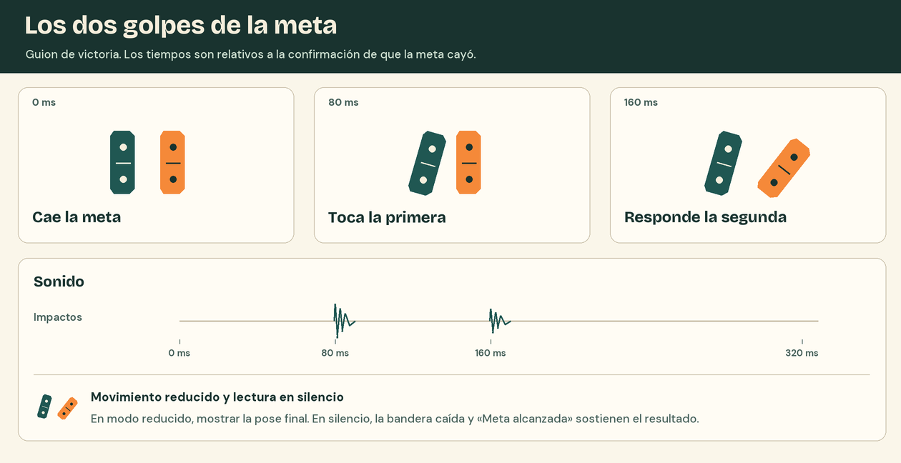

# Movimiento y sonido

El ritmo de una fila permite escuchar hasta dónde llegó el empujón. La caída de cada ficha lleva un golpe corto de madera. Cuando la cadena cambia de material, la rodadura o el clic de la compuerta permiten seguir el relevo incluso si la pieza queda momentáneamente detrás de la taza.

## Qué mueve y qué suena

| Evento | Imagen | Sonido y sincronía |
| --- | --- | --- |
| Armado | Piezas quietas y huella pegada al apoyo. Al confirmar, la ficha queda en la posición elegida. | Ambiente de cocina tenue y estable. Un toque suave confirma una colocación. El simple paso del puntero permanece silencioso. |
| Empujón y fila | La primera ficha inicia la caída. Cada vecina cambia de orientación al recibir el impacto. | Disparar cada «tac» con el contacto correspondiente. Usar pequeñas variaciones de timbre entre contactos equivalentes. En una fila rápida deben oírse la cadencia y su interrupción. |
| Bolita | La veta de color gira al rodar. El paso de rampa a canal y la salida del extremo son visibles. | La rodadura entra al empezar a rodar sobre un apoyo. Ajustar su intensidad a la velocidad, cortarla en el aire y retomarla al aterrizar. La madera suena seca y la canaleta produce una resonancia breve. |
| Paleta y llave | La paleta cede al golpe y la hoja se aparta del canal. La apertura persiste. Una bola temprana queda en el desvío. | Un clic único al abrir. Si la bola cae en la bandeja, un impacto corto y grave cierra su recorrido. |
| Cadena detenida | Las piezas conservan la pose en la que se detuvieron. El resultado aparece en la bandeja. | El último contacto cierra la secuencia. La guitarra recupera volumen cuando aparece el resultado y pasaron al menos 350 ms desde ese contacto. |
| Meta | El sello con la bandera a cuadros identifica la ficha durante la edición. Al empujar desaparecen ambos sellos. El remate aparece cuando termina la caída y se asientan las piezas. | Los contactos siguen sonando durante la caída. Los dos golpes de la firma acompañan el resultado. |

En la mezcla, dar prioridad al transitorio de la madera y al clic. Mantener la rodadura audible por debajo de esos contactos y el ambiente un plano más atrás. Escuchar una pasada con los parlantes de una computadora al volumen habitual. Debe distinguirse cuándo la última ficha deja el movimiento en manos de la bolita.

## Las guitarras y la mezcla

«Pregunta y Respuesta» y «Una ficha más» alternan desde el primer gesto. Una misma canción puede acompañar el paso de Desafíos al taller. El empujón baja la guitarra 12 dB en 150 ms. La vuelta al volumen elegido dura 800 ms y, al ganar, empieza después de la firma. La cámara lenta conserva el tempo musical. Ocultar la pestaña pausa la reproducción.

En Preferencias, Música (40 %) regula las guitarras, Mesa (85 %) las herramientas y los contactos físicos, Ambiente (25 %) la cocina e Interfaz (65 %) la navegación, los avisos y la firma. El botón de la cabecera silencia la mezcla completa y permite recuperarla con esos mismos valores.

## El remate de dos fichas

| Tiempo de interfaz | Pose y golpe |
| --- | --- |
| 0 ms | Las piezas están en reposo y pasó al menos un segundo de simulación desde la victoria. Aparecen el texto de victoria y las dos fichas de marca en la bandeja. |
| 80 ms | La primera ficha llega a 16° hacia la derecha. Coincide con un golpe de madera seco. |
| 160 ms | La segunda llega a 38°. Coincide con un segundo golpe más corto y algo más agudo. Es la pose del símbolo estático. |
| Desde 160 ms | Sostener la firma y las opciones hasta que el jugador elija. Los controles pueden usarse desde la confirmación de victoria. |

Son tiempos iniciales para producir la firma. Los 60° corresponden al comportamiento de la meta física. Los 16° y 38° describen únicamente la inclinación de las fichas dibujadas en la interfaz.

## Repetición y alternativas perceptivas

- **Repetición.** Restablecer compuerta, silencios de rodadura y estado de la firma al inicio de cada intento. Al volver a editar, interrumpir los sonidos activos para que el siguiente empujón empiece limpio.
- **Cámara lenta.** Los impactos y el clic siguen el instante visible del contacto. Mantener su ataque reconocible y espaciar los eventos según el tiempo de simulación. La firma de interfaz usa sus propios tiempos después de confirmarse el resultado.
- **Movimiento reducido.** Mostrar directamente la pose final junto a «Meta alcanzada». Conservar la trayectoria física que el jugador necesita observar, la cámara bajo su control y el mismo acceso a las opciones.
- **Audio apagado.** El texto persistente y la pose final de la meta dejan reconocer la victoria. En un fallo, las posiciones finales y «Cadena detenida» permiten inspeccionar el corte. Comprobar ambos resultados en silencio, incluido un paso de llave abierto a tiempo y otro con la bolita en la bandeja.
