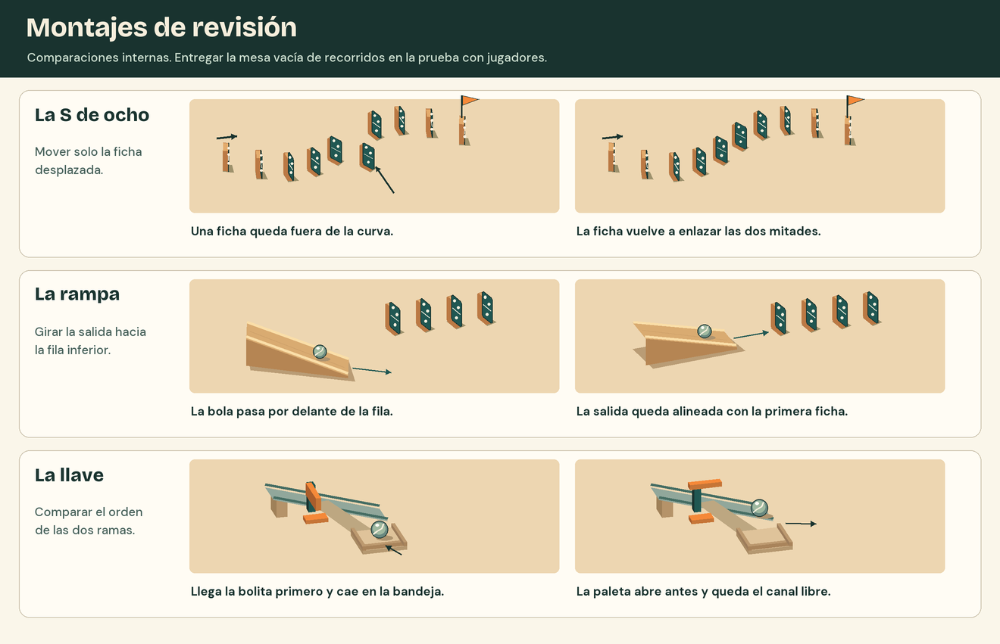

# Hoja de validación

Usar la primera sección para revisar ilustraciones a escala de juego. Copiar las tablas de las secciones siguientes por sesión de pruebas del prototipo. Los casilleros vacíos admiten resultados y observaciones cuando haya un montaje ejecutable.

## Revisión de las maquetas

| Recorrido de revisión | Qué comparar |
| --- | --- |
| Reparar la S | Contar ocho fichas intermedias además de inicio y meta. Localizar la ficha corrida, seguir el hueco y comprobar en el segundo dibujo que solo esa ficha vuelve a su sitio. En el editor, debe poder corregirse individualmente después de dibujar la fila. |
| Reorientar la rampa | Seguir la dirección de la salida en ambos dibujos. En el primero la bola pasa de largo. En el segundo apunta a la primera ficha inferior. La cámara tiene que dejar ver ese encuentro. |
| Distinguir los resultados de la llave | En el primer dibujo se ven la hoja cerrada y la bola en la bandeja. En el segundo se ven la hoja apartada, el paso libre y la bola que continúa. Tapar los pies de figura e identificar cada resultado por la posición de los objetos. |
| Revisar mesa y controles | Abrir las vistas [oblicua](laminas/taza-oblicua.png) y [superior](laminas/taza-superior.png) al 100 %. Localizar ambos extremos, el saldo de las cuatro piezas y «Empujar». Contrastar el punto de apoyo con el [recorte a escala real](laminas/apoyo-1a1.png). |

## Sesión con cinco jugadores nuevos

**Preparación.** Anotar versión del prototipo, fecha, dispositivo y tamaño del área de juego. Preparar una S reparable con una sola ficha desplazada y el nivel de la taza en su estado inicial. Cada participante trabaja por separado. Reservar los recorridos resueltos y la lámina de revisión para el equipo.

1. Tras completar La recta, abrir La curva y pedir «Trazá una S de ocho fichas y probala». Entregar después la copia con una ficha corrida y pedir que repare el corte. Registrar si completa **ambas tareas sin ayuda**.
2. Mostrar la taza con su objetivo e inventario. Registrar la primera ruta y qué pieza cambia tras un fallo. Observar si el grupo descubre el descenso con fichas y la transferencia a la bolita.
3. En una pasada con el audio apagado, pedir que identifique un intento detenido y una victoria. Preguntar qué vio y dónde cree que se cortó la cadena. Tras ganar, registrar la primera acción que elige y por qué.

| Persona | Traza S sola | Repara sola | Primera ruta en la taza y ajuste | Fallo / victoria sin audio y señal que usó | Primera acción tras ganar |
| --- | --- | --- | --- | --- | --- |
| 1 | | | | | |
| 2 | | | | | |
| 3 | | | | | |
| 4 | | | | | |
| 5 | | | | | |

**Resultado conjunto:** ____ / 5 trazan **y** reparan sin ayuda. Objetivo del MVP: **4 de 5**. Familias de solución observadas en la taza: ____. Si cuesta trazar, revisar gesto y separación. Si cuesta reparar, revisar selección, encuadre y retorno al editor. Si el sonido resulta indispensable, registrar la señal visual que pasó inadvertida y el estado en que ocurrió.

## Pasadas técnicas en escritorio

**Equipo y compilación:** ____ · **Sistema y GPU:** ____ · **Fecha:** ____ · **Herramienta de medición:** ____. Usar el mismo equipo y un área de juego de **1366 × 768 píxeles CSS**, con zoom del navegador al 100 %. Identificar los dos navegadores y sus versiones.

| Navegador y versión | Mesa, inventario y Empujar visibles | Alrededor de la taza, FPS por segundo durante la cadena (mínimo observado) | ¿Mantiene al menos 30 FPS? | Montaje, instante de caída y observaciones |
| --- | --- | --- | --- | --- |
| A · ____ | | | | |
| B · ____ | | | | |

Para la medición, usar el recorrido mixto de la taza desde «Empujar» hasta la caída de la meta o el reposo. Anotar la menor lectura por intervalo de un segundo y cualquier caída perceptible. Repetir el mismo montaje en ambos navegadores. El objetivo inicial es **mantener 30 FPS** en el equipo informado.

**Control de contactos.** Conservar la S, el descenso por rampa, las dos soluciones de la taza y las variantes temprana y tardía de la llave. Por cada montaje y navegador, hacer diez pasadas en el mismo equipo, incluidas dos a cámara lenta. Completar una fila por combinación. Registrar el orden de los contactos decisivos, además del desenlace.

| Montaje / navegador | Orden esperado | Normales coincidentes / 8 | Lentas coincidentes / 2 | Primera diferencia y resultado |
| --- | --- | --- | --- | --- |
| ____ / ____ | | | | |

Comprobar una vuelta al editor durante el movimiento y otra después de ganar. Registrar si se recuperan posiciones, orientaciones, saldo y compuerta cerrada. Comprobar también que una bola que sale de la mesa permite terminar el intento y que la victoria y su remate ocurren una sola vez.
