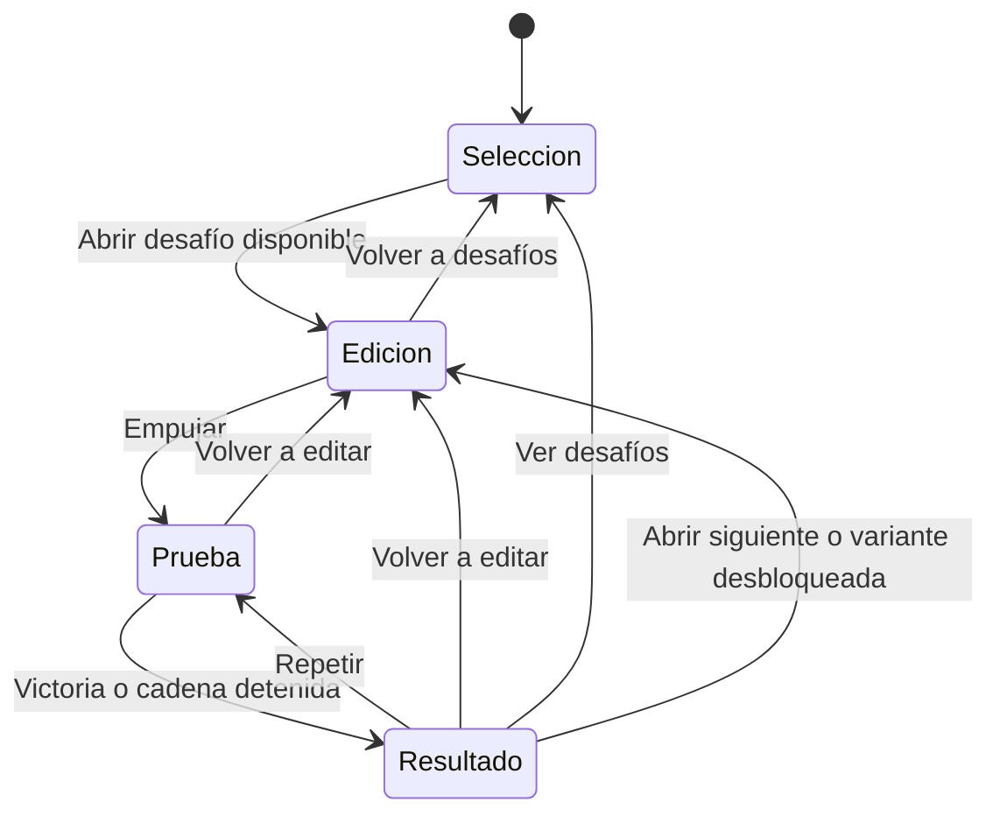

# Arquitectura y ejecución

Tuki se ejecuta en una pestaña de escritorio con mouse. Una aplicación TypeScript servida por GitHub Pages abre el selector, carga el desafío elegido y mantiene la edición y la prueba en la misma vista. El único servicio necesario en producción es el alojamiento de archivos estáticos.

## Responsabilidades

| Responsable | Datos que controla | Interfaz con el resto del juego |
| --- | --- | --- |
| Control de partida | Desafío actual, fase, último armado probado y resultado | Acepta acciones permitidas en la fase actual. Al entrar en prueba entrega una copia inmutable del armado a física. Al ganar comunica la finalización al progreso. |
| Editor | Piezas colocadas, saldo, historial, selección y gesto en curso | Recibe coordenadas del mouse y superficies seleccionables. Publica previsualizaciones y ediciones confirmadas. Solo estas últimas alteran el armado. |
| Catálogo y niveles | Formas físicas, huellas, puntos de entrada y salida, unidades, inventarios, disposición de cada desafío y perfil de calibración | Entregan datos validados a editor, presentación y física. Un identificador estable vincula la pieza a su modelo, colisionadores y eventos. |
| Simulación Rapier | Mundo físico del intento, reloj por pasos, posiciones, velocidades, cadena de contactos y llave | Recibe el armado una vez. Devuelve poses y eventos con número de paso e identificador de pieza. Puede ejecutarse en pruebas sin DOM ni GPU. |
| Presentación Three.js | Escena WebGL 2, cámara, luces, modelos e indicadores sobre la mesa | Proyecta el mouse al mundo y dibuja poses. Orbitar, cambiar de vista o redimensionar el lienzo conserva selección y armado. |
| Interfaz HTML y audio | Controles con foco, textos, anuncio del resultado, contexto Web Audio y voces activas | Traducen gestos a acciones y consumen eventos. La confirmación de victoria inicia el remate con tiempo propio de interfaz. |
| Progreso local | Desafíos completados y preferencias | Lee al iniciar, guarda al ganar o cambiar un ajuste y calcula los desafíos disponibles. El mismo resultado se puede registrar varias veces sin duplicar progreso. |

## Estados de la partida

Al abrir un desafío por primera vez, el editor muestra sus objetos fijos, el inventario completo y la cámara oblicua. Al elegir «Siguiente» se abre el siguiente nivel con su propio encuadre. Al regresar a un desafío abierto en esa pestaña se recupera su armado en memoria.

«Empujar» cierra la previsualización sin confirmarla y captura únicamente ediciones confirmadas. La transición de estado consume el clic antes de iniciar el intento, incluso ante un doble clic. El primer empujón se observa a 1×. El mando de velocidad alterna 1× y 0,25× en prueba y resultado. «Repetir» conserva esa elección, de modo que se puede ver una caída entera en lenta desde el primer contacto. La cámara responde en edición, prueba y resultado. Un resultado congela las poses, presenta las acciones de inmediato y persiste hasta la elección del jugador.

## De un gesto a un fotograma

1. El DOM o el canvas entrega una acción al control de partida. En edición, el editor confirma un cambio atómico y Three.js redibuja su resultado. El editor también puede mostrar una silueta transitoria entre dos confirmaciones.
2. Al empujar, Rapier construye un mundo a partir de los datos del nivel y del armado. Crea todos los cuerpos según un orden estable y aplica el impulso de inicio. La copia previa queda en memoria junto al historial de edición.
3. Un solo `requestAnimationFrame` mide el tiempo transcurrido mientras la pestaña es visible. En prueba lo multiplica por la velocidad elegida y lo acumula. Por cada paso completo disponible, física avanza el mismo intervalo, procesa contactos y comprueba el desenlace. Para proteger la respuesta del mouse, cada fotograma dispone de aproximadamente 12 ms de trabajo síncrono para recuperar pasos pendientes, con un límite adicional de 240 pasos. Se conserva el resto del acumulador sin descartar tiempo. El paso físico sigue siendo 1/120 s: un renderizado lento no limita la simulación a ocho pasos por imagen.
4. Three.js interpola las dos últimas poses para dibujar la mesa. Si llega un resultado, dibuja el estado físico exacto de ese paso. La interfaz y el audio reciben los eventos en orden de simulación. Al ocultarse la pestaña se pausa el reloj y el audio. Al volver, se toma una nueva referencia de tiempo real.
5. «Volver a editar» invalida los eventos pendientes del intento, libera el mundo y sus colas y vuelve a dibujar la copia previa. «Repetir» usa esa misma copia, reinicia los contadores y permite observar de nuevo desde la cámara elegida. Cada intento tiene su propio identificador.

## Arranque y recursos

Vite compila TypeScript y empaqueta los módulos. HTML y CSS componen la cabecera y la bandeja. Inicializar WebGL 2 y cargar el catálogo y los recursos del primer desafío antes de habilitar la interacción correspondiente. Cargar una única instancia de `@dimforge/rapier3d-compat` y esperar `RAPIER.init()` antes de habilitar «Empujar». Esta distribución incluye el WASM dentro del módulo JavaScript y se puede servir junto con el juego. [Inicio de Rapier para JavaScript](https://rapier.rs/docs/user_guides/javascript/getting_started_js/)

Si falla un recurso esencial, identificarlo en el diagnóstico y ofrecer «Reintentar» en el DOM. Mantener el armado si ya existía. Si el navegador carece de WebGL 2, explicar en esa misma pantalla qué requisito necesita la mesa. Al cambiar de nivel, quitar los listeners y objetos propios del nivel y conservar en caché los modelos compartidos mientras la aplicación los use.

[Índice técnico](README.md) · [Ciclo físico del intento](fisica.md) · [Contratos del editor](editor-y-niveles.md)
